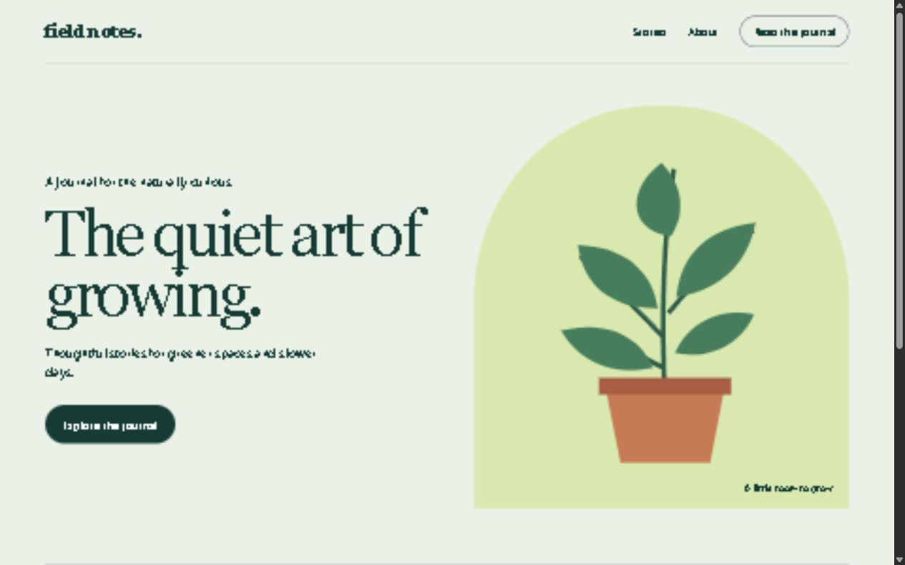
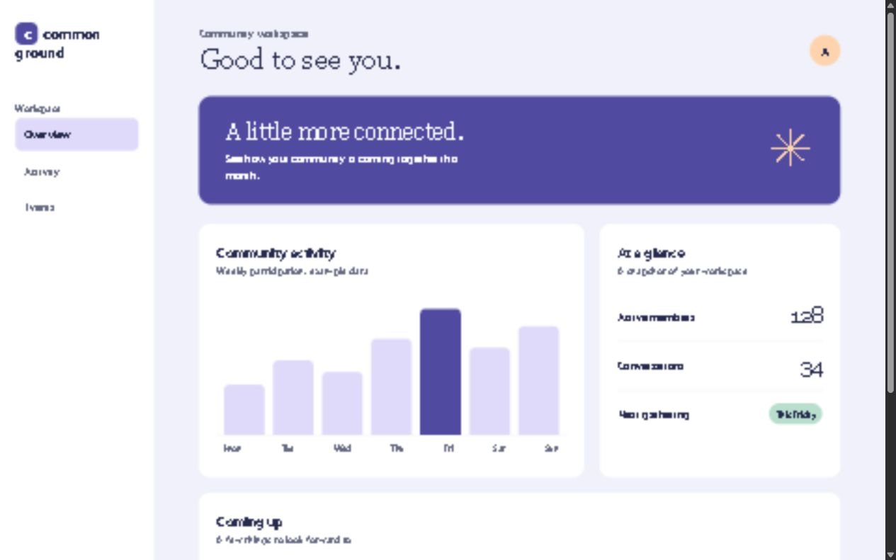

# Free Web Libraries for Codex

A Codex skill for choosing free web libraries and design resources. It helps compare frameworks, components, fonts, icons, illustrations and CDN options, with attention to licensing, accessibility, compatibility and production use.

## Install

Clone this repository, then run its installer.

**macOS / Linux**

```sh
git clone https://github.com/ojeshfrrr/free-web-libraries-skill.git && sh free-web-libraries-skill/install.sh
```

**Windows PowerShell**

```powershell
git clone https://github.com/ojeshfrrr/free-web-libraries-skill.git; if ($LASTEXITCODE -eq 0) { & .\free-web-libraries-skill\install.ps1 }
```

Requires Git. Both installers refuse to overwrite an existing skill. Restart Codex, then ask for `$free-web-libraries` or describe a website task involving free libraries and design resources. To update, review the new version and remove or move the existing skill before rerunning the installer.

## Examples

Two self-contained, fictional sites demonstrate the skill's guidance. They use native HTML, CSS and inline SVG, with no external dependencies or build step. Open the HTML files in a browser. Dashboard numbers and events are illustrative only.

### Field Notes — editorial journal



[Open source](examples/field-notes/index.html)

### Common Ground — community dashboard



[Open source](examples/quiet-metrics/index.html)

## What's included

- `skill/SKILL.md` — the skill entry point.
- `skill/references/` — library, design, and CDN research guides with links to primary sources.
- `examples/` — example website source.
- `images/` — screenshots of the examples.

The guide is a starting point, not a guarantee that a specific asset, service or library remains free. Check current documentation and licenses before use. Hosting, domains and third-party services may have separate costs.
