# Free Web Libraries for Codex

A Codex skill for choosing free web libraries and design resources. It helps compare frameworks, components, fonts, icons, illustrations and CDN options, with attention to licensing, accessibility, compatibility and production use.

## Install

Clone this repository, then run its installer.

**macOS / Linux**

```sh
git clone https://github.com/ojeshfrrr/free-web-libraries-skill.git && sh free-web-libraries-skill/install.sh
```

**Windows PowerShell**

```powershell
git clone https://github.com/ojeshfrrr/free-web-libraries-skill.git; if ($LASTEXITCODE -eq 0) { & .\free-web-libraries-skill\install.ps1 }
```

Requires Git. Both installers refuse to overwrite an existing skill. Restart Codex, then ask for `$free-web-libraries` or describe a website task involving free libraries and design resources. To update, review the new version and remove or move the existing skill before rerunning the installer.

## Examples

Twelve fictional websites demonstrate the skill's guidance across different visual styles and interactions. They use native HTML, CSS and JavaScript, with no external dependencies or build step. Clone the repository and open `examples/index.html` to browse the gallery, or open any example's `index.html` directly. All brands, numbers, events and forecasts are illustrative. The ocean image in Below the Blue is AI-generated; other artwork is drawn in code. The listening-room animation has no audio.

### Ten new examples

| Example | Concept | Source |
| --- | --- | --- |
| Below the Blue | Cinematic deep-sea expedition | [HTML](examples/abyss/index.html) |
| Frequency | Interactive listening room | [HTML](examples/frequency/index.html) |
| Orbital | Night-sky field guide | [HTML](examples/orbit/index.html) |
| Letterform | Interactive typography playground | [HTML](examples/kinetic-type/index.html) |
| Forma | Ceramics studio | [HTML](examples/atelier/index.html) |
| Saffron Table | Supper club and menu | [HTML](examples/supper-club/index.html) |
| Museum of Small Things | Fictional object archive | [HTML](examples/archive/index.html) |
| Chromatic | Interactive color palette explorer | [HTML](examples/palette/index.html) |
| Wayfarer | Trail journal | [HTML](examples/trail/index.html) |
| Weather Window | Illustrated forecast concept | [HTML](examples/weather/index.html) |

<details><summary>View all ten screenshots</summary>

**Below the Blue**
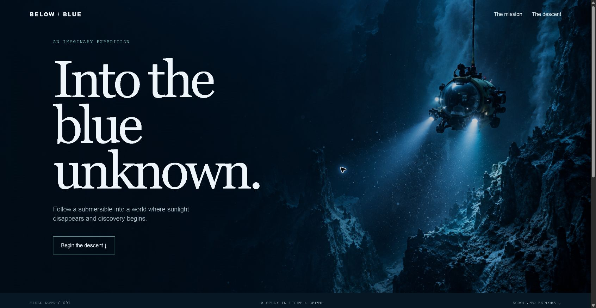

**Frequency**
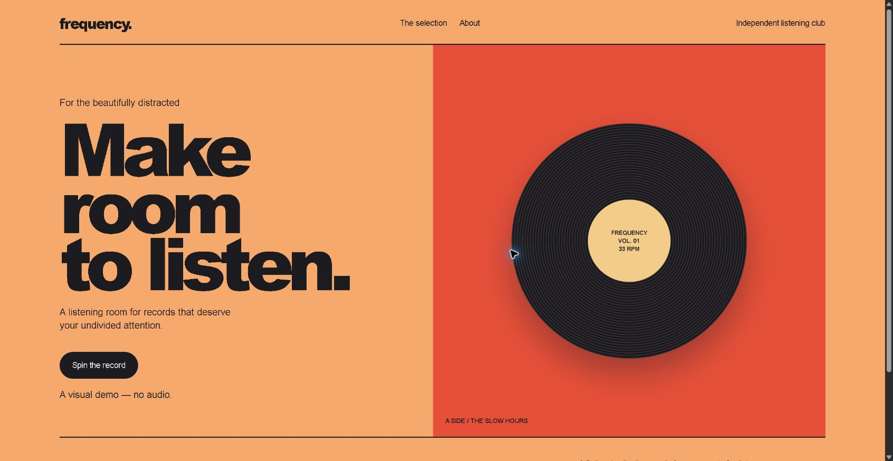

**Orbital**
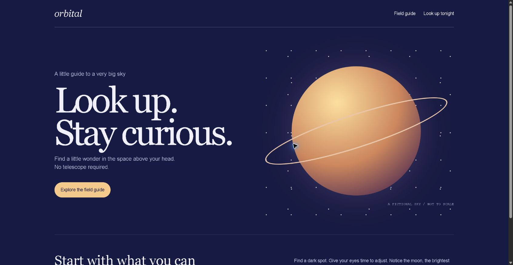

**Letterform**
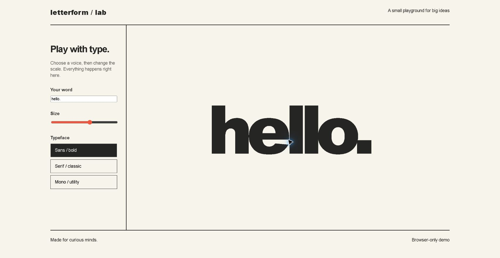

**Forma**
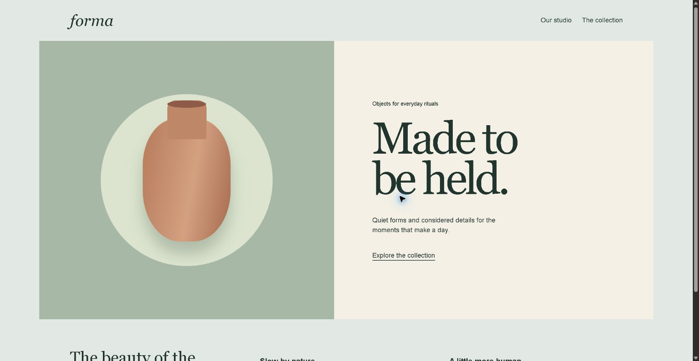

**Saffron Table**
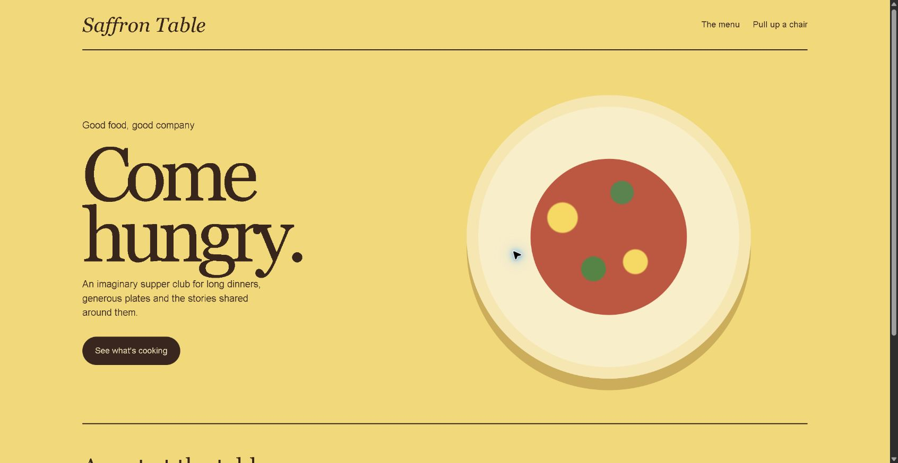

**Museum of Small Things**
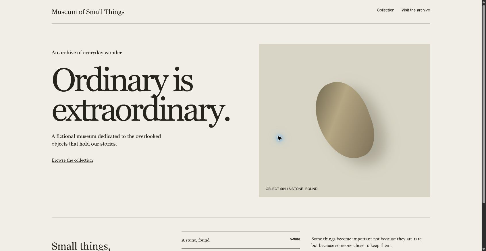

**Chromatic**
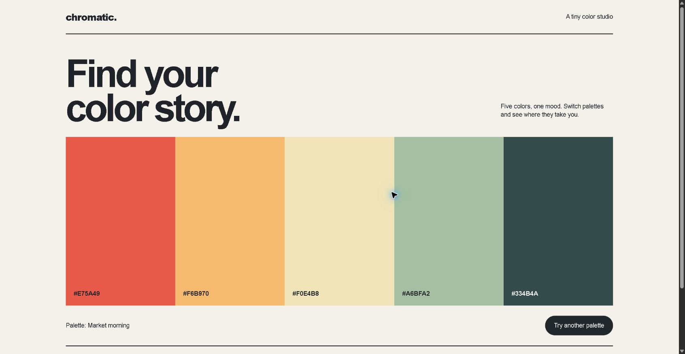

**Wayfarer**
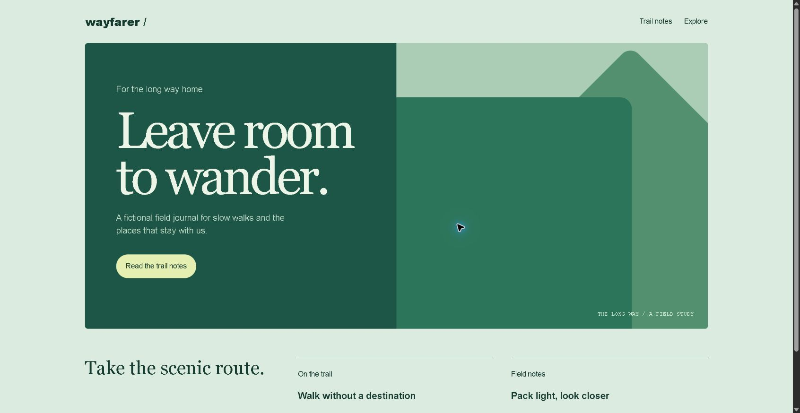

**Weather Window**
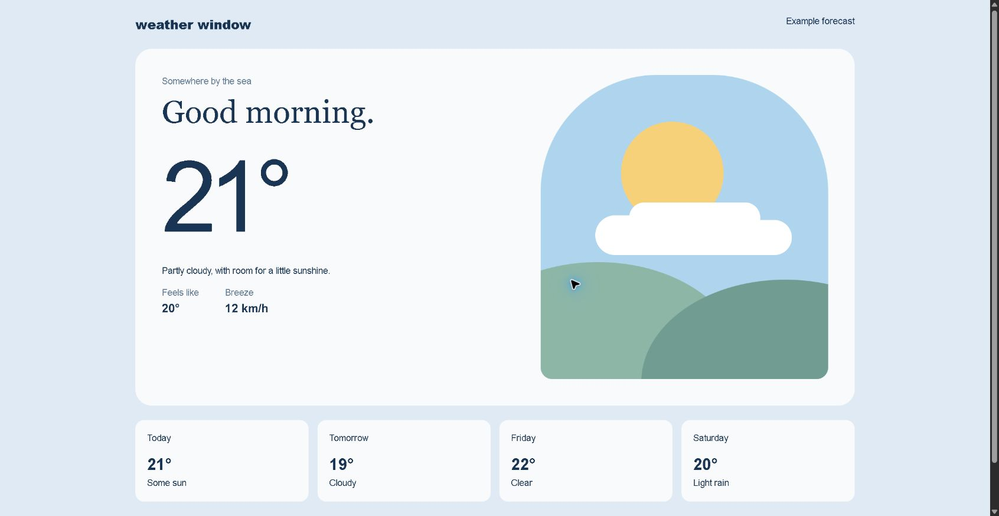

</details>

### Earlier examples

### Field Notes — editorial journal

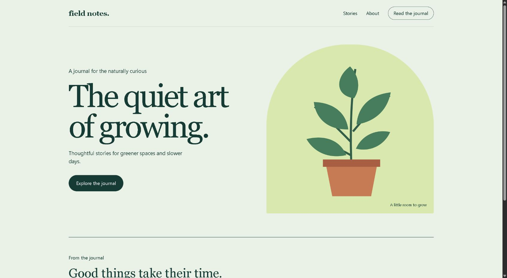

[Open source](examples/field-notes/index.html)

### Common Ground — community dashboard

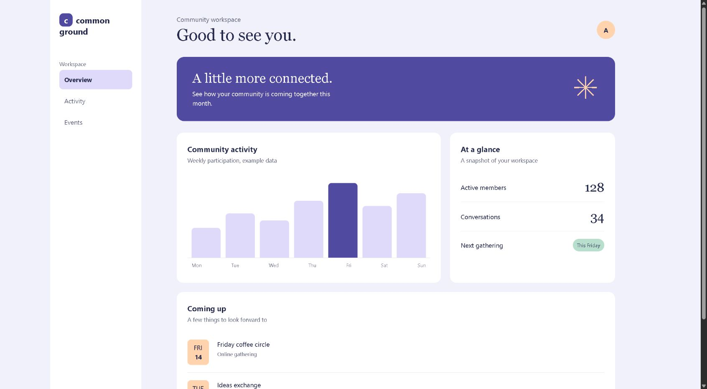

[Open source](examples/quiet-metrics/index.html)

## What's included

- `skill/SKILL.md` — the skill entry point.
- `skill/references/` — library, design, and CDN research guides with links to primary sources.
- `examples/` — example website source.
- `images/` — screenshots of the examples.

The guide is a starting point, not a guarantee that a specific asset, service or library remains free. Check current documentation and licenses before use. Hosting, domains and third-party services may have separate costs.
